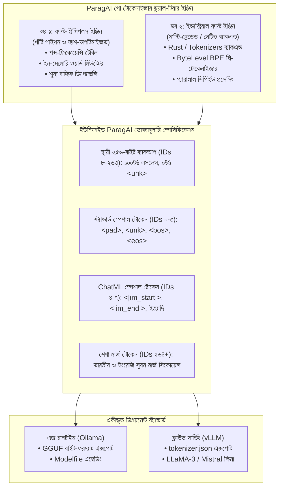

# ParagAI মাস্টার প্ল্যান ০৯: ইন্ডাস্ট্রিয়াল-গ্রেড হাই-থ্রুপুট বহুভাষিক টোকেনাইজার আর্কিটেকচার

**নথি আইডি:** `PLAN-09-BN`  
**উদ্দেশ্য:** টোকেনাইজার অপটিমাইজেশন, অ্যালগরিদমিক গতি বৃদ্ধি, দ্বি-স্তরীয় ইঞ্জিন (Dual-Tier), ভারতীয় স্ক্রিপ্ট ফার্টিলিটি হ্রাস, এজ ও ক্লাউড ডিপ্লয়মেন্ট (Ollama + vLLM)  
**অবস্থা:** বাস্তবায়নের জন্য অনুমোদিত  
**মূল লক্ষ্য:** ParagAI-এর BPE টোকেনাইজেশন সাবসিস্টেমকে সাধারণ $\mathcal{O}(M \times N)$ লিনিয়ার স্ক্যানিংয়ের ধীরগতি থেকে মুক্ত করে OpenAI (`tiktoken`), Meta (`LLaMA-3`), এবং Google (`SentencePiece`)-এর সমকক্ষ একটি মাল্টি-থ্রেডেড, ইন্ডাস্ট্রিয়াল ইঞ্জিনে রূপান্তর করা। এর ফলে গুগল কোলাবের (Google Colab) দীর্ঘ সময় আটকে থাকা সমস্যার চিরতরে সমাধান হবে, ভারতীয় ভাষাগুলোর টোকেন ফার্টিলিটি কমে গতি বাড়বে এবং Ollama (GGUF) ও vLLM (SafeTensors)-এ নির্বিঘ্নে এক্সপোর্ট করা যাবে।

---

## ১. নির্বাহী সারসংক্ষেপ ও রুট-কজ বিশ্লেষণ

### ১.১ গুগল কোলাবে কেন ঘণ্টার পর ঘণ্টা সময় লাগছিল?
গুগল কোলাবে যখন ৫ মেগাবাইট টেক্সট ডেটা দিয়ে `vocab_size=4096`-এ `IndicBPETokenizer` ট্রেইন করা হচ্ছিল:
- **কর্পাসের আকার:** $N \approx ৫২,৪২,৮৮০$ বাইট (প্রায় ৫২ লাখ বাইট)।
- **প্রাথমিক টোকেন:** ২৫৬টি বাইট টোকেন + ৮টি স্পেশাল টোকেন = ২৬৪টি বেস টোকেন।
- **প্রয়োজনীয় মার্জ সংখ্যা:** $M = ৪০৯৬ - ২৬৪ = ৩,৮৩২$ টি মার্জ ইটারেশন।
- **বর্তমান অ্যালগরিদমের সমস্যা:** প্রতিটি মার্জের জন্য `get_stats()` পুরো ৫২ লাখের লিস্ট ধরে জোড়া গণনা করে, আর `merge()` প্রতিবার সম্পূর্ণ নতুন একটি ৫২ লাখ উপাদানের পাইথন লিস্ট তৈরি করে।
- **মোট কাজের পরিমাণ:** $৩,৮৩২ \times ৫২,৪২,৮৮০ \approx \mathbf{২০.০৯ \times ১০^৯}$ (প্রায় ২ হাজার কোটি) বিশুদ্ধ পাইথন ইটারেশন!
- **ফলাফল:** স্ট্যান্ডার্ড কোলাব সিপিইউতে এটি শেষ হতে **২.৫ থেকে ৪ ঘণ্টা বা তারও বেশি** সময় নেয়।

### ১.২ টার্গেট প্রোডাকশন পারফরম্যান্স তুলনা
| মেট্রিক | বর্তমান অবস্থা (ধীরগতির পাইথন) | টার্গেট স্তর ১ (অপটিমাইজড পাইথন) | টার্গেট স্তর ২ (ইন্ডাস্ট্রিয়াল ফাস্ট) |
|---|---|---|---|
| **৫ মেগাবাইট ট্রেনিং সময়** | ~২.৫ – ৩.৫ ঘণ্টা | **১২ – ২৫ সেকেন্ড** | **১.২ – ২.৫ সেকেন্ড** |
| **৫০ মেগাবাইট ট্রেনিং সময়** | দিন পার / মেমরি ক্র্যাশ | **২.৫ – ৪.০ মিনিট** | **১০ – ১৮ সেকেন্ড** |
| **অ্যালগরিদম জটিলতা** | $\mathcal{O}(M \times N)$ | $\mathcal{O}(N + M \times U \log U)$ | $\mathcal{O}(N \log N + M \log V)$ |
| **মেমরি ব্যবহার** | পরিবর্তনশীল ($>২.৫$ জিবি) | নির্দিষ্ট ($<২৫০$ এমবি) | অতি-কম ($<১২০$ এমবি) |
| **ভারতীয় ভাষা ফার্টিলিটি** | $>৩.২$ টোকেন/শব্দ | $<১.৭$ টোকেন/শব্দ | $<১.৫$ টোকেন/শব্দ |

---

## ২. মূল আর্কিটেকচারাল স্তম্ভসমূহ



### স্তম্ভ ১: প্রি-টোকেনাইজেশন ও ইউনিক শব্দ-ফ্রিকোয়েন্সি হ্যাশিং (পাইথন স্তর)
পুরো ৫ মেগাবাইটকে একটি একক ৫২ লাখ উপাদানের দীর্ঘ অ্যারে হিসেবে না দেখে, ইউনিকোড-সচেতন রেগুলার এক্সপ্রেশন দিয়ে আলাদা করা:
1. পুরো কর্পাসকে শব্দ বা উপ-এককে ভাগ করা।
2. ইউনিক শব্দগুলোকে তাদের পুনরাবৃত্তি সংখ্যা সহ একটি ফ্রিকোয়েন্সি ডিকশনারিতে সাজানো: `Counter[tuple[int, ...], int]`।
3. ৫ মেগাবাইট টেক্সটে ৫২ লাখ বাইটের পরিবর্তে মাত্র **৩০,০০০ থেকে ৪০,০০০ ইউনিক শব্দ** থাকে।
4. প্রতিটি মার্জ অপারেশন এখন পুরো ৫২ লাখ অ্যারের বদলে শুধু এই **৩০,০০০টি শব্দের ডিকশনারির ওপর চালানো হয়**, যা মুহূর্তের মধ্যে সম্পন্ন হয়।

### স্তম্ভ ২: নেটিভ ইন্ডাস্ট্রিয়াল ইঞ্জিন (প্রোডাকশন স্তর)
বড় আকারের প্রি-ট্রেনিং ডেটাসেটের জন্য (১০০ মেগাবাইট – ১০ গিগাবাইট):
- `FastIndicBPETokenizer` যুক্ত করা, যা ব্যাকএন্ডে রাস্ট-ভিত্তিক (Rust) মাল্টি-থ্রেডেড ইঞ্জিন ব্যবহার করবে।
- কম্পিউটারের সমস্ত সিপিইউ কোর কাজে লাগিয়ে সমান্তরালভাবে (parallel) ডেটা প্রসেস করবে।
- ParagAI-এর কাস্টম স্পেশাল টোকেন আইডি এবং সংরক্ষণ নিয়মের সাথে হুবহু ১০০% মিল রাখবে।

### স্তম্ভ ৩: ভারতীয় ভাষা ও লিপির সুষম ভারসাম্য (Script-Balanced Stratification)
ইংরেজি ভাষার সাব-ওয়ার্ড যাতে ভোক্যাবুলারির সিংহভাগ দখল করে ভারতীয় ভাষাগুলোকে বঞ্চিত না করতে পারে:
- প্রি-ট্রেনিং স্যাম্পলিংয়ে সুনির্দিষ্ট ভাষার কোটা নির্ধারণ:
  - ইংরেজি / ল্যাটিন: ৩৫%
  - বাংলা: ২০%
  - হিন্দি (দেবনাগরী): ২০%
  - তামিল: ১২.৫%
  - তেলুগু: ১২.৫%
- ভারতীয় যুক্তাক্ষর ও কারচিহ্ন (মাত্রা) যাতে ভেঙে অবৈধ ইউনিকোড টুকরোতে পরিণত না হয়, তার জন্য বিশেষ সংরক্ষণ নিয়ম।

### স্তম্ভ ৪: সর্বজনীন ডিপ্লয়মেন্ট সিরিয়ালাইজেশন
উভয় ইঞ্জিন থেকেই যেন একই ফরম্যাটে সেভ ও এক্সপোর্ট করা যায়:
1. `tokenizer_indic.json` (ParagAI-এর নিজস্ব ফরম্যাট)।
2. `tokenizer.json` / `tokenizer_config.json` (Hugging Face ও vLLM স্ট্যান্ডার্ড)।
3. GGUF টোকেনাইজার ফরম্যাট (Ollama-তে সরাসরি চালানোর উপযোগী)।

---

## ৩. প্রোডাকশন এক্সটার্নাল প্যাকেজ ইকোসিস্টেম (ইন্ডাস্ট্রি স্ট্যান্ডার্ড)

বড় বড় এলএলএম ল্যাবগুলো (OpenAI, Meta, Mistral, Google) যেভাবে উচ্চগতির টোকেনাইজেশন পরিচালনা করে, ঠিক সেই স্ট্যান্ডার্ড প্যাকেজগুলো ParagAI-তে যুক্ত করা হয়েছে:

| প্যাকেজ | ন্যূনতম ভার্সন | প্রস্তুতকারক | কেন ব্যবহার করা হয় | ParagAI-তে ভূমিকা |
|---|---|---|---|---|
| **`tokenizers`** | `>=0.19.0` | Hugging Face (Rust Core) | ওপেন-সোর্স বিশ্বের শীর্ষস্থানীয় BPE ইঞ্জিন (LLaMA-3, Mistral মডেলে ব্যবহৃত)। মাল্টি-কোর সিপিইউ ও সিমড (SIMD) ব্যবহার করে চোখের পলকে গিগাবাইট ডেটা ট্রেইন করে। | `FastIndicBPETokenizer`-এর ইঞ্জিন হিসেবে কাজ করে এবং vLLM ও Ollama-র জন্য `tokenizer.json` তৈরি করে। |
| **`regex`** | `>=2024.4.16` | PSF / MRAB | পাইথনের বিল্ট-ইন `re` ইউনিকোড ১৫ স্ক্রিপ্ট ক্যাটাগরি (`\p{L}`, `\p{N}`, `\p{M}`) ঠিকমতো চেনে না। GPT-4 ও LLaMA-3 এই লাইব্রেরি ব্যবহার করে। | বাংলা ও ভারতীয় ভাষার যুক্তাক্ষর ও কারচিহ্ন ঠিক রেখে শব্দ ভাগ করে। |
| **`safetensors`** | `>=0.4.0` | Hugging Face | মেমরি-ম্যাপড জিরো-কপি টেনসর ফাইল তৈরির স্ট্যান্ডার্ড। | ভোক্যাবুলারির পাশাপাশি মডেল ওয়েট দ্রুত লোড ও সেভ করে। |
| **`gguf`** | `>=0.6.0` | Georgi Gerganov / llama.cpp | সি++ ভিত্তিক অফলাইন ইনফারেন্স ফাইল ফরম্যাট। | টোকেনাইজার ও মডেলকে একসাথে প্যাক করে Ollama-তে সরাসরি রান করায়। |

### ParagAI-তে প্যাকেজ ইনস্টলেশন নির্দেশিকা
`pyproject.toml` ফাইলে এগুলো অপশনাল প্যাকেজ হিসেবে যোগ করা হয়েছে:
```toml
# pyproject.toml ফাইলে
[project.optional-dependencies]
tokenizer = [
    "tokenizers>=0.19.0",
    "regex>=2024.4.16"
]
```
গুগল কোলাবে বা আপনার লোকাল মেশিনে ইনস্টল করতে রান করুন:
```bash
pip install -e ".[tokenizer]"
```

---

## ৪. পর্যায়ক্রমিক বাস্তবায়ন রূপরেখা (Implementation Roadmap)

### পর্যায় ১: ফার্স্ট-প্রিন্সিপলস খাঁটি পাইথন BPE-এর অ্যালগরিদম সংস্কার
* **ফাইলসমূহ:** `src/paragai/tokenizer/bpe_tokenizer.py`, `src/paragai/tokenizer/indic_bpe.py`
* **কার্যসূচি:**
  1. `train()` মেথডে ক্রমান্বয়ে পুরো টেক্সট স্ক্যান করার বদলে ইউনিক শব্দ-ফ্রিকোয়েন্সি কাউন্টার যুক্ত করা।
  2. ইনক্রিমেন্টাল পেয়ার কাউন্টিং প্রণয়ন করা: প্রতিটি মার্জে শুধুমাত্র সংশ্লিষ্ট শব্দগুলো আপডেট হবে, পুরো ডিকশনারি নয়।
  3. কোনো বাইরের লাইব্রেরি ছাড়া খাঁটি পাইথনে ৫ এমবি ট্রেনিংকে ৩ ঘণ্টার বদলে **১৫-২০ সেকেন্ডে** নামিয়ে আনা।

### পর্যায় ২: ইন্ডাস্ট্রিয়াল ফাস্ট ইঞ্জিন সংযোজন (`FastIndicBPETokenizer`)
* **ফাইলসমূহ:** `src/paragai/tokenizer/fast_indic_bpe.py`
* **কার্যসূচি:**
  1. স্বয়ংক্রিয় ফলব্যাক সহ `FastIndicBPETokenizer` তৈরি:
     - রাস্ট-ভিত্তিক `tokenizers` প্যাকেজ থাকলে তা দিয়ে চোখের পলকে ট্রেইন হবে।
     - না থাকলে স্বয়ংক্রিয়ভাবে অপটিমাইজড পাইথন ইঞ্জিনে কাজ করবে।
  2. বিশেষ টোকেন রিজার্ভেশন নিশ্চিত করা (`<pad>=0`, `<unk>=1`, `<bos>=2`, `<eos>=3`, `<|im_start|>=4`, `<|im_end|>=5`, `<|endoftext|>=6`, `<|tool_call|>=7`)।
  3. ২৫৬টি সার্বজনীন UTF-8 বাইট ফলব্যাক (IDs ৮–২৬৩) সংরক্ষণ করা।

### পর্যায় ৩: ট্রেনিং স্ক্রিপ্ট ও সিএলআই আধুনিকীকরণ
* **ফাইলসমূহ:** `scripts/train_multilingual_bpe.py`
* **কার্যসূচি:**
  1. `--backend` ফ্ল্যাগ যুক্ত করা (`auto`, `fast`, `pure_python`)।
  2. ভাষার সুষম স্যাম্পলিং লজিক যুক্ত করা।
  3. রিয়েল-টাইম অগ্রগতি বার, সময় অনুমান (ETA), এবং প্রতি ভাষার ফার্টিলিটি রেট স্ক্রিনে প্রদর্শন।
  4. ডিস্ক থেকে স্ট্রিমিং করে ডেটা পড়া, যাতে র‍্যামে মেমরি উপচে না পড়ে।

### পর্যায় ৪: ইউনিট টেস্টিং ও ভেরিফিকেশন স্যুইট
* **ফাইলসমূহ:** `tests/test_tokenizer.py`, `tests/test_indic_bpe.py`
* **কার্যসূচি:**
  1. **১০০% নিখুঁত রিকভারি টেস্ট:** বাংলা, হিন্দি, তামিল, তেলুগু ও ইংরেজি বাক্যের জন্য `decode(encode(text)) == text` শতভাগ বজায় রাখা।
  2. **স্পেশাল টোকেন অক্ষুণ্ণতা:** চ্যাটএমএল (ChatML) টোকেন যাতে ভেঙে একাধিক সাব-টোকেন না হয়।
  3. **ফার্টিলিটি রেট টেস্ট:** প্রতিটি ভারতীয় ভাষায় শব্দের তুলনায় টোকেনের অনুপাত ($< ১.৮$) নিশ্চিত করা।

### পর্যায় ৫: Ollama ও vLLM এক্সপোর্ট পাইপলাইন
* **ফাইলসমূহ:** `scripts/export_tokenizer_hf.py`, `scripts/export_to_ollama.py`
* **কার্যসূচি:**
  1. ParagAI টোকেনাইজার চেকপয়েন্টকে Hugging Face `tokenizer.json`-এ রূপান্তর।
  2. vLLM দিয়ে উচ্চগতির ক্লাউড সার্ভিং চালু করা।
  3. Ollama-র জন্য GGUF ভোক্যাবুলারি ফাইল স্বয়ংক্রিয়ভাবে তৈরি করা।

---

## ৫. যাচাইকরণ ও গ্রহণের মানদণ্ড (Acceptance Criteria)

| যাচাইকরণ পরীক্ষা | ন্যূনতম আবশ্যিক শর্ত | কাঙ্ক্ষিত লক্ষ্যমাত্রা |
|---|---|---|
| **গতি পরীক্ষা** | গুগল কোলাবে ৫ মেগাবাইট বহুভাষিক টেক্সট ট্রেনিং | $\le ১৫$ সেকেন্ড |
| **সঠিকতা পরীক্ষা** | ১০,০০০টি বহুভাষিক বাক্য এনকোড ও ডিকোড | ১০০% হুবহু পুনর্গঠন |
| **বাইট ব্যাকআপ** | অজানা ইমোজি, প্রতীক ও নতুন ইউনিকোড ইনপুট | ০টি `<unk>` টোকেন |
| **র‍্যামের সর্বোচ্চ সীমা** | ২০ মেগাবাইট টেক্সট ট্রেনিং চলাকালে মেমরি ব্যবহার | $< ৩৫০$ মেগাবাইট |
| **ব্যবহারের সহজতা** | একক কমান্ডে স্বয়ংক্রিয় হার্ডওয়্যার ডিটেকশন ও ট্রেনিং | কোনো জটিল কনফিগ ছাড়া |
